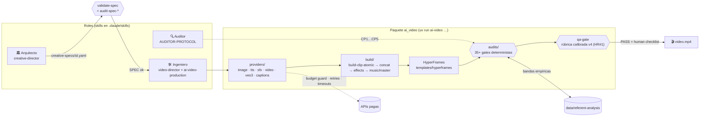

# AI Video — sistema de producción de videos cortos con IA

[](https://github.com/tomashanna/ai-video/actions/workflows/ci.yml)


> **EN —** A spec-driven system to design, generate, assemble and *audit* short vertical videos
> made with generative AI (image → TTS → SFX → image-to-video → HyperFrames composition → −14 LUFS
> master). A creative **spec** (YAML, schema-validated) is the contract between an *architect* agent
> that designs the story and an *engineer* agent that renders it; 35+ deterministic **gates** and an
> independent *auditor* verify every checkpoint against measured referent data. Paid API calls go
> through a budget guard with retries and timeouts. Docs are in Spanish; code and identifiers in English.

---

## Qué hace

1. **Diseña** — el rol *arquitecto* (skill `creative-director`) produce un `creative-spec` v11: historia,
   personajes, guion palabra por palabra, shot list con intención visual y de audio.
2. **Valida** — `ai-video validate-spec` (pydantic) + validators de SPEC (voseo, clichés, voces
   superpuestas, narración que no entra en el shot, estructura canónica del formato…).
3. **Genera** — imagen (Gemini), voz y SFX (ElevenLabs), animación image-to-video (Kling vía Replicate,
   Veo 3.1), captions con Whisper. Todo con **presupuesto**, **reintentos con backoff** y **timeouts**.
4. **Ensambla** — pipeline HYBRID: clip atómico por shot (visual + voz + SFX + captions quemados) →
   concat → transiciones → música/ducking → master −14 LUFS → overlay UI en HyperFrames.
5. **Audita** — gates deterministas sobre SPEC y render (safe zones, cobertura temporal de captions,
   mezcla, LUFS, pacing de UI de decisión, cobertura de audio…) + juez Gemini calibrado (rúbrica v4)
   + checklist humano. Un rol *auditor* independiente verifica cada checkpoint.

## Arquitectura



Capas (el cambio se aísla por alcance):

| Capa | Dónde | Qué |
|---|---|---|
| A — universal | `src/ai_video/`, `.claude/skills/ai-video-production`, `video-director`, `creative-director` | Toolkit técnico y roles, agnósticos de género |
| A.5 — familia | `.claude/skills/choice-format-core` | Mecánica común de los formatos "choice" (dyad, countdown, A/B, counterfactual) |
| B — formato | `.claude/skills/<formato>-format` | Sabor de género (horror-choice, sport-choice): pautas creativa y técnica, referencias |
| C — por video | `creative-specs/<id>.yaml` + `projects/<id>/` (locales) | El SPEC y los assets de cada video |

Detalle operativo (hard rules, gates por checkpoint, triggers de skills): [`docs/OPERATING-MANUAL.md`](docs/OPERATING-MANUAL.md).

## Quickstart

Requisitos: Python ≥ 3.11, [uv](https://docs.astral.sh/uv/), `ffmpeg`/`ffprobe`; Node ≥ 22 solo para renderizar con HyperFrames.

```bash
git clone https://github.com/tomashanna/ai-video.git && cd ai-video
uv sync --extra providers            # + --extra media para Whisper/OpenCV, --all-extras para todo
cp .env.example .env                 # completar solo las keys que vayas a usar
uv run ai-video doctor               # binarios, extras y keys (nunca imprime valores)
uv run ai-video list                 # todos los tools

# Validar un SPEC y correr gates de SPEC (sin red, sin costo)
uv run ai-video validate-spec examples/specs/ultimo-tren-carga.yaml
uv run ai-video audit-language-style --format horror-choice --spec examples/specs/ultimo-tren-carga.yaml
uv run ai-video audit-spec-voice-exclusivity --mode spec --format horror-choice --spec examples/specs/ultimo-tren-carga.yaml

# Generar (APIs pagas): siempre probar primero con --dry-run (valida + estima costo)
uv run ai-video tts -t "Elige a tu compañero." -o narration.mp3 --dry-run
uv run ai-video budget               # gasto estimado acumulado vs. tope
```

Proyecto nuevo de punta a punta: [`.claude/skills/ai-video-production/BOOTSTRAP.md`](.claude/skills/ai-video-production/BOOTSTRAP.md).

## Configuración

Toda la configuración entra por variables de entorno (o `.env` en la raíz del repo / directorio actual).
Ver [`.env.example`](.env.example).

| Variable | Default | Para qué |
|---|---|---|
| `GEMINI_API_KEY` | — | Imagen, Veo 3.1, audits con Gemini Vision |
| `ELEVENLABS_API_KEY` | — | TTS y SFX |
| `REPLICATE_API_TOKEN` | — | Kling image-to-video |
| `AIVIDEO_BUDGET_USD` | `10` | Tope de gasto **estimado**; el guard rechaza llamadas que lo superen |
| `AIVIDEO_SPEND_LEDGER` | `.ai-video/spend.jsonl` | Ledger append-only de gasto |
| `AIVIDEO_DRY_RUN` | `false` | Validar y estimar sin llamar APIs |
| `AIVIDEO_PRICE_<KEY>` | ver `budget.py` | Override de precio unitario (p. ej. `AIVIDEO_PRICE_VEO_PER_S=0`) |
| `AIVIDEO_HTTP_TIMEOUT_S` / `AIVIDEO_MAX_RETRIES` / `AIVIDEO_POLL_TIMEOUT_S` | `120` / `3` / `900` | Timeouts, reintentos y espera máxima de generaciones largas |
| `AIVIDEO_LOG_LEVEL` / `AIVIDEO_LOG_JSON` | `INFO` / `false` | Logging estructurado (con redacción de secretos) |
| `AIVIDEO_RENDER_LOCK` | `~/.claude-render-lock.json` | Lock global de renders entre agentes |
| `AIVIDEO_REPO_ROOT`, `REFERENT_ANALYSIS_DIR`, `AIVIDEO_HARD_RULES_PATH` | autodetectado | Overrides de rutas (tests / layouts no estándar) |

Guardrails: keys como `SecretStr` (nunca en logs ni `repr`), *fail fast* con mensaje accionable si falta
una key, filtro de logs que enmascara formatos de keys conocidos, subprocess siempre con lista de
argumentos + timeout (nunca `shell=True`), YAML con `safe_load` y límite de tamaño, descargas solo `https`.

## Estructura

```
├── src/ai_video/          # paquete Python (CLI: ai-video)
│   ├── providers/         #   ElevenLabs, Gemini, Replicate, Veo, Whisper (budget + retries)
│   ├── build/             #   clip atómico, concat, efectos, música, orquestador, render-lock
│   ├── audits/            #   gates deterministas sobre SPEC y render + qa-gate
│   ├── spec/              #   schema v11 + validate-spec
│   ├── research/          #   medición de referentes
│   ├── core/              #   bandas empíricas, similarity, state machine
│   └── config.py · budget.py · retry.py · log.py · paths.py · proc.py
├── tests/unit/            # pytest (APIs mockeadas, sin red)
├── evals/                 # harness de evals offline (ver evals/README.md)
├── assets/                # librería SFX/música/voces, transiciones, AVUs, presets de voz
├── templates/             # componentes HyperFrames (countdown/loader/lower-third) + project template
├── data/referent-analysis # mediciones numéricas sanitizadas de referentes (bandas F1)
├── examples/specs/        # 3 creative specs v11 reales de referencia
├── docs/                  # manual operativo, hard rules, roadmap, metodología, docs de tools
├── scripts/               # helpers shell (master-audio, check-pacing, burn-captions, health-check)
├── .claude/skills/        # skills de los roles (arquitecto, ingeniero, auditor, editor, formatos)
└── .agents/skills/        # skills HyperFrames vendorizadas (Apache-2.0)
```

## Tests, evals y calidad

```bash
uv run pytest                        # ~565 tests; los que sintetizan media se saltean sin ffmpeg
uv run python -m evals.run           # 24 casos: spec, captions, safe zones, rúbrica, render
uv run ruff check . && uv run ruff format --check .
uv run mypy                          # estricto en la capa de infraestructura
bash scripts/health-check.sh         # invariantes de higiene del repo
pre-commit install                   # ruff, gitleaks, guard de archivos >5 MB, EOF/whitespace
```

CI (GitHub Actions): lint, typecheck, tests (con ffmpeg), evals y escaneo de secretos con gitleaks.

## Roadmap

- Reducir la deuda de tipos: 13 módulos legacy aún excluidos de mypy (lista explícita en `pyproject.toml`).
- Reemplazar los `--format` + flags booleanos de los gates por un objeto `Spec` tipado compartido.
- `ai-video run <spec>`: orquestación end-to-end CP1→CP5 con checkpoints reanudables.
- Evals de render sobre renders reales con `GeminiJudge` (calibración periódica contra puntaje humano).
- Formato `sport-choice` con referencias medidas propias (hoy pre-empírico).
- Ver [`docs/AUTONOMOUS-FACTORY-ROADMAP.md`](docs/AUTONOMOUS-FACTORY-ROADMAP.md).

## Contribuir · Seguridad · Licencia

- [CONTRIBUTING.md](CONTRIBUTING.md) — setup, convenciones (Conventional Commits), cómo agregar un gate.
- [SECURITY.md](SECURITY.md) — cómo reportar vulnerabilidades y política de secretos.
- [CHANGELOG.md](CHANGELOG.md).
- Código bajo licencia [MIT](LICENSE) © Tomás Hanna. Componentes de terceros: [THIRD_PARTY_NOTICES.md](THIRD_PARTY_NOTICES.md).
